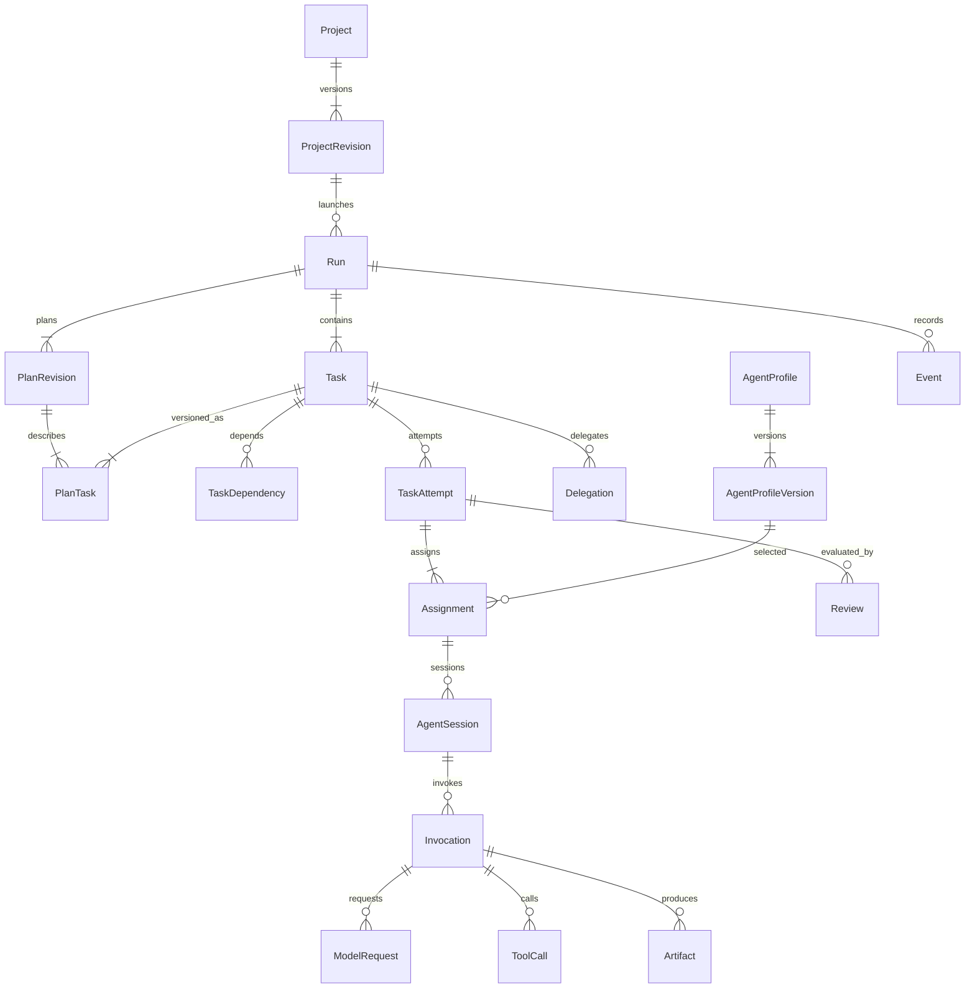

# Модель даних

Статус: логічна схема, не SQL-міграція. [Навігація](README.md).

## 1. Головні зв'язки

Кожна сутність має opaque ID, timestamps UTC та schema version там, де зберігається payload. Порядок подій визначає cursor/sequence, а не час системного годинника. UI відображає час у часовому поясі користувача.

## 2. Налаштування та каталог

| Сутність | Ключові поля | Важливе правило |
| --- | --- | --- |
| Project | id, name, kind, currentRevisionId, archivedAt | Стабільна ідентичність, не запуск |
| ProjectRevision | projectId, number, goal, sourceRefs, acceptanceCriteria, teamPolicy, resourcePolicy, contextPolicy | Immutable; унікальна `(projectId, number)` |
| ProviderConnection | adapterKind, endpointRef, secretRef, enabled, health | Секрет окремо; endpoint configuration має версію |
| ModelDescriptor | connectionId, modelKey, capabilities, pricingVersionId, verifiedAt | Не ототожнювати display name з modelKey |
| AgentProfile | name, currentVersionId, archivedAt | Можна використовувати в кількох проєктах |
| AgentProfileVersion | role, skills, instructions, backendKind, modelPolicy, toolPolicy, delegationPolicy, contextPolicy | Immutable; зміна не переписує активні призначення |
| ProjectAgentBinding | projectRevisionId, profileVersionId, enabled, allowedRoles, overrides | Overrides зведені в snapshot і перевірені policy |
| WorkflowTemplateVersion | taskSpecs, teamSlots, gates, outputSchemas | Шаблон копіюється в план; редагування шаблону не змінює запуски |
| PlanProposal | projectRevisionId, sourcePlanningRunId, taskSpecs, teamSlots, status, acceptedBy | Ручна або модельна пропозиція; не активний план виконання |
| PolicyVersion | scope, limits, permissions, approvalRules | Розширення прав явне; термінові заборони можуть діяти на активні запуски |

## 3. Запуск і задачі

| Сутність | Ключові поля | Важливе правило |
| --- | --- | --- |
| Run | projectRevisionId, kind, currentPlanRevisionId, status, controlIntent, version, startedAt, deadline | `kind`: planning або execution; snapshot конфігурації + актуальні відкликання прав |
| PlanRevision | runId, number, parentRevisionId, changeReason, acceptedBy | Immutable; зміна активного плану через одну транзакцію |
| Task | runId, status, currentAttemptId, version | Стабільний ID логічної задачі, опис знаходиться в PlanTask |
| PlanTask | planRevisionId, taskId, title, instructions, acceptanceCriteria, requiredCapabilities, teamSpec, outputSchema | `(planRevisionId, taskId)` unique; потрібний attempt зберігає точне посилання |
| TaskDependency | planRevisionId, taskId, predecessorId, artifactContract, failurePolicy | DAG у межах одного запуску; залежність від прийнятого результату |
| TaskAttempt | taskId, planRevisionId, number, status, inputSnapshotRef, reason, resultRef | Помилка/перепланування створює нову спробу; історія не затирається |
| Assignment | attemptId, profileVersionId, role, backendSnapshot, routingDecisionId | Фіксує фактичний вибір агента, моделі та конфігурації |
| AgentSession | assignmentId, parentSessionId, contextSnapshotRef, externalSessionRef, capabilitiesSnapshot | Одна оренда на зміну сесії; не використовувати конкурентно без capability |
| Delegation | parentTaskId, parentAttemptId, childTaskId, creatorInvocationId, joinPolicy, inheritedPolicyRef | Дитина має одного керівника; ancestor cycles заборонені |
| AgentMessage | runId, senderSessionId, recipientRef, kind, artifactRefs, sequence | Повідомлення не є командою диспетчера; права на отримання перевіряються |

Залежності задач і делегування — різні зв'язки. `parentTaskId` не замінює `dependsOn`. Дитина може використовувати завершені матеріали батька, але не чекати фінального завершення цього батька: це створює deadlock. Перевіряються також цикли очікування між деревом делегування та DAG залежностей.

Автопланування запускається після збереження draft ProjectRevision як допоміжний Run типу `planning` з однією наперед заданою задачею планувальника. Його вихід — PlanProposal, а не команда старту задач. Це дає плануванню ті самі бюджети, журнал, permissions і recovery. Ручний PlanProposal не потребує planning Run. Після прийняття пропозиція копіюється у PlanRevision нового execution Run; планування не рекурсивно планує саме себе.

## 4. Виконання, результати та контроль

| Сутність | Ключові поля | Важливе правило |
| --- | --- | --- |
| Invocation | attemptId, assignmentId, sessionId, kind, status, externalHandle, idempotencyKey, leaseEpoch | Результат приймається лише від актуального власника оренди |
| ModelRequest | invocationId, requestNumber, modelSnapshot, inputRef, outputRef, usage, providerRequestId | Унікальний requestNumber; невідомий outcome допускається |
| ToolCall | invocationId, name, argsHash, policyDecisionId, externalOperationId, effectStatus, resultRef | Може мати побічний ефект, навіть якщо відповідь втрачено |
| Artifact | runId, attemptId, producerInvocationId, type, hash, blobRef, metadata, acceptanceStatus | Immutable bytes; нова версія — новий hash/record |
| Review | attemptId, reviewerAssignmentId, artifactHashes, criteriaVersion, verdict, reportRef | Схвалення дійсне тільки для перевірених версій результату |
| Workspace | runId, ownerAttemptId, rootRef, baseCommit, leaseEpoch, status, integrationRef | Підтверджене завершення writer перед наступним writer |
| Approval | actionKind, targetId, inputHash, policyVersion, state, expiresAt, decidedBy | Зміна аргументів/результату робить попередній дозвіл непридатним |
| PolicyDecision | subject, action, scope, policyVersion, outcome, reasonCodes | Аудит дозволених і заборонених дій |
| Job | kind, targetId, state, availableAt, priority, leaseOwner, leaseUntil, leaseEpoch | Конкурентне отримання через транзакційне compare-and-set |
| Worker | capabilities, hostRef, heartbeatAt, status | Втрата heartbeat не доводить, що зовнішній процес зупинився |
| ResourceReservation | runId, attemptId, kind, amount, state, expiresAt | Резерв/списання/звільнення мають audit trail |
| UsageEntry | invocationId, providerEventKey, quantity, unit, amount, currency, pricingVersion, certainty | `measured / estimated / unknown`; дублікати не списуються вдруге |
| Event | id, cursor, runSequence, aggregateId, type, schemaVersion, payloadRef, causationId, correlationId | Append-only, унікальний `(runId, runSequence)` |
| OutboxEntry | eventId, destination, deliveryState, retryAt | Повторна доставка допустима; consumer дедуплікує |
| CommandReceipt | actorId, idempotencyKey, requestHash, responseRef | Повтор тієї самої команди повертає той самий результат |

Тариф і валюта зберігаються разом із записом обліку. Перерахунок за новим тарифом — окремий звіт, не редагування минулої фактичної вартості.

## 5. Границі транзакцій

**Створення запуску:** перевірити expected project revision → зафіксувати snapshot і PlanRevision → створити Tasks → записати jobs → event/outbox → commit. Відповідь клієнту лише після commit.

**Отримання job:** перевірити його готовність та права → перевірити місткість ресурсів → зарезервувати ресурси → змінити lease epoch → позначити Invocation → event/outbox → commit. Запуск зовнішнього процесу відбувається після транзакції; випадок падіння між commit та запуском покривається recovery.

**Завершення:** перевірити lease epoch та idempotency → перевірити output schema і committed artifacts → завершити Invocation/Attempt або почати review → звірити usage та резерви → зробити наступні jobs доступними → event/outbox → commit.

**Делегування:** перевірити батька, ліміти, capabilities, права, граф очікування й увесь список дітей → створити plan revision, children, delegations і jobs → перевести батька у waiting_children → event/outbox → commit. Часткове додавання дітей при помилці заборонене.

**Зміна плану:** перевірити expected revision → обчислити affected tasks і артефакти → застосувати правила для активних/завершених задач → створити нову ревізію → invalidation та нові спроби → events → commit. HTTP timeout не означає відкат committed команди; клієнт перевіряє CommandReceipt.

DB-транзакція не може атомарно змінити зовнішній API або файлову систему. ArtifactStore спочатку записує staging blob, перевіряє hash і завершує розміщення, після чого БД фіксує reference. Фоновий cleanup знаходить orphan blobs; recovery знаходить відсутні файли. Неповний artifact ніколи не стає прийнятим результатом.

## 6. Індекси, обсяг і міграції

Необхідні індекси: jobs `(state, availableAt, priority)`; jobs `(leaseOwner, leaseUntil)`; tasks `(runId, status)`; attempts `(taskId, number)`; events `(runId, runSequence)`; dependencies `(planRevisionId, predecessorId)`; delegations `(parentTaskId)`; usage `(runId, createdAt)` через пряме поле або матеріалізовану проєкцію.

JSON зберігає змінні snapshots, provider payloads та schemas; статуси, ідентичності, зв'язки, оренди й поля фільтрації — типізовані колонки. Повний stdout, prompt і файли зберігаються як artifacts з політикою доступу та retention.

Міграція має версію, backup перед руйнівною зміною та перевірку сумісності сервера/worker. Імпорт JSON-прототипу — окремий одноразовий importer з dry-run і звітом; старий файл зберігається. Snapshot БД та manifest артефактів утворюють узгоджений backup.

## 7. Незмінні правила

1. Run належить одній ProjectRevision; зміна поточної ProjectRevision не змінює Run.
2. TaskAttempt належить точній PlanRevision; завершений attempt не редагується.
3. Немає ребер між задачами різних Run; reuse можливий лише через явно імпортований artifact.
4. Застарілий lease не може прийняти результат, списати usage вдруге чи інтегрувати зміни.
5. Рецензія і дозвіл прив'язані до hash результату/дії.
6. Скасування — намір, доки worker не підтвердив зупинку; `cancelled` не встановлюється завчасно.
7. Модель не створює записи прав чи executable-конфігурації через свій текстовий вихід.
8. Секрет не є частиною snapshot, event або export проєкту.
