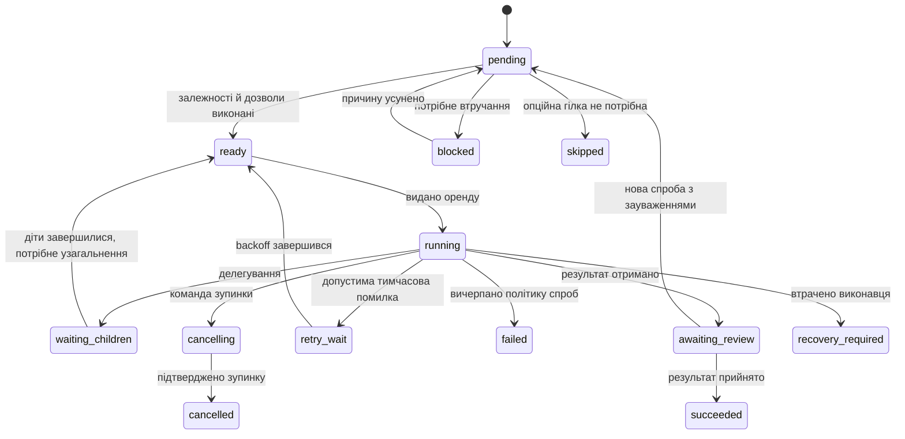

# Модель виконання

Статус: цільова семантика. [Навігація](README.md).

## 1. Від мети до результату

1. Користувач створює або редагує проєкт: мета, джерела, критерії приймання, команда, бюджети й права.
2. Планувальник пропонує задачі, залежності, outputs та рольові слоти. Пропозиція проходить структурну валідацію; спосіб прийняття визначає режим автономності користувача.
3. Routing підбирає допустимих агентів, пояснює вибір і прогнозує ресурси. Неуспішний preflight не запускає оплачувану роботу.
4. Контролер створює Run зі snapshot і планом; scheduler видає лише готову роботу з ресурсами й актуальними дозволами.
5. Worker отримує оренду, контекст і workspace, виконує backend та надсилає події.
6. Виходи проходять schemas, критерії приймання, тести та задану стратегію review. Прийнятий artifact стає доступним залежним задачам.
7. Інтеграція перевіряє спільний результат. Run завершується лише після завершення обов'язкових задач і gates; опційні невдачі явно зазначаються.

Планування з використанням моделі також є облікованою роботою: після збереження draft-ревізії створюється допоміжний `Run(kind=planning)` з фіксованою задачею. Він повертає PlanProposal. Основний `Run(kind=execution)` отримує прийняту пропозицію як початковий план. Ручний план оминає лише модельну стадію, зберігаючи валідацію.

## 2. Стани

### Run

| Стан | Значення | Основні переходи |
| --- | --- | --- |
| `created` | Snapshot збережений | planning, ready, cancelled |
| `planning` | План формується або перевіряється | ready, waiting_input, failed, cancelling |
| `ready` | План валідний, запуск дозволений | running, cancelling |
| `running` | Є робота або очікування ресурсів | pausing, waiting_input, cancelling, succeeded, failed |
| `pausing` | Нові виклики заборонено, поточні завершуються | paused, cancelling, recovery_required |
| `paused` | Немає активних неконтрольованих викликів | running, cancelling |
| `waiting_input` | Для продовження потрібне рішення, альтернативної готової роботи немає | running, planning, cancelling |
| `cancelling` | Виконуються зупинки та звірка стану | cancelled, recovery_required |
| `recovery_required` | Невідомий зовнішній результат або стан процесу | running, cancelling, failed після звірки |
| `succeeded / failed / cancelled` | Термінальні стани | Новий запуск або fork; історія незмінна |

`waiting_input` не блокує незалежну роботу завчасно: поки вона виконується, Run лишається running, а UI показує незакриті питання окремо.

### Task та Attempt

Схема показує основні переходи, а не всі дозволені ребра. З будь-якого нетермінального стану можлива команда cancel; для невиконуваної задачі її можна підтвердити одразу. `blocked` має reason code і є відновлюваним; якщо причина остаточна й немає recovery policy, залежна задача завершується `skipped` з failure reason. Обов'язкова пропущена задача не дозволяє успіх Run.

Task — поточний логічний стан; Attempt — історія спроб. Результат спроби: `accepted`, `rejected`, `failed`, `cancelled`, `unknown`. Новий attempt потрібен при retry, зміні суттєвих входів або fallback, який починає роботу заново. Продовження після дітей може бути наступним Invocation тієї самої спроби з новим context snapshot.

## 3. Стратегії команд

| Стратегія | Виконання | Критерій завершення |
| --- | --- | --- |
| Single | Один виконавець | Результат відповідає контракту й gates |
| Parallel candidates | Кілька незалежних відповідей на одну задачу | Арбітр/користувач приймає кандидата або результат synthesis |
| Pipeline | Послідовні ролі | Фінальний вихід останнього етапу проходить gates |
| Implement–review | Виконавець і незалежний рецензент | Вердикт з доказами, ліміт циклів виправлення |
| Debate | Кілька раундів позицій та критики | Ліміт раундів, арбітр, явний фінальний результат |
| Vote | Відповіді зі спільною schemas | Кворум, правило нічиєї, арбітр при розбіжності |
| Manager–workers | Керівник делегує підзадачі | Join policy дітей і прийняте узагальнення |

Виконання команди розгортається у явні внутрішні steps/Invocations. Стратегії не ховають додаткові виклики від бюджетного обліку. Звичайне об'єднання текстів не позначається консенсусом. Голосування доречне лише для результатів, для яких визначено спосіб порівняння; більшість голосів не є доказом істини.

Для `parallel candidates` є параметри `minimumSuccesses`, `partialFailurePolicy`, `selectionPolicy`, `maxCandidates`. Невдача одного кандидата не обов'язково обнуляє успішні відповіді інших. Рецензія оцінює конкретні artifact hashes за версією критеріїв; текст «все добре» без валідного контракту не завершує задачу.

## 4. Субагенти та повідомлення

Делегування надходить як структурований command proposal: parent invocation, список task specs, required roles, необхідні materials, join policy та ідемпотентний ключ. Policy перевіряє можливість делегування, глибину, fan-out, загальну кількість дітей, бюджет, права й відсутність циклу очікування.

Ефективні права дитини — перетин прав проєкту, батьківської спроби та її профілю. Батько не може видати дитині новий executable, secret або мережевий дозвіл. DelegationBudget належить гілці; children витрачають спільний резерв, а не отримують повну копію бюджету батька.

Після створення дітей батько звільняє модельний слот і worker lease, поки чекає. Workspace утримується лише якщо це потрібно для незавершених змін; тоді дочірні writers отримують інші workspace. Інакше можлива взаємна блокіровка ресурсів.

Join policies: `all_required`, `quorum`, `best_effort`. За замовчуванням — усі обов'язкові діти. Скасування батька каскадно зупиняє нащадків; скасування дитини запускає перевірку join policy. Незалежні задачі поза піддеревом продовжуються.

Mailbox підтримує повідомлення task context, feedback, question і artifact reference. Для доставки потрібні права на referenced artifacts. Прямі вказівки іншого агента не змінюють план, права або бюджет; зміна проходить через контролер. Загальну спільну mutable пам'ять для всіх агентів не вводимо.

## 5. Паралельність і ресурси

Ліміти діють одночасно на рівнях: сервер → provider/account → проєкт → Run → команда → session/workspace. Локальні моделі додатково використовують resource pool GPU/RAM. Самої кількості HTTP-запитів недостатньо для контролю ресурсів.

Scheduler застосовує пріоритет і справедливе чергування між проєктами; aging не дає звичайним задачам чекати нескінченно. Задача готова, коли: залежності прийняті, gates закриті, контекст підготовлений, права актуальні, бюджет зарезервований і потрібні слоти доступні.

Резервування набору ресурсів виконується атомарно або у фіксованому порядку з повним відкатом. Задача не тримає модельний слот, чекаючи дозволу користувача. Rate limiting відрізняється від concurrency; 429 впливає на час наступної спроби й стан health провайдера.

## 6. Пауза, скасування, зміна плану

**Пауза:** забороняє починати нові зовнішні кроки; активні завершуються до контрольної точки. Для CLI без checkpoint пауза очікує завершення поточної команди. UI не обіцяє миттєвого призупинення процесу. Примусова зупинка — окрема дія cancel із наслідками для recovery.

**Скасування:** durable intent → відмова у нових lease → signal до worker → завершення дерева процесів/HTTP → звірка external outcome → фінальні events → звільнення ресурсів. Поки процес може писати у workspace, lease на наступного writer не видається. Витрати вже розпочатого запиту можуть надійти після cancel; usage ledger приймає їх із поясненням.

**Редагування проєкту:** нова ProjectRevision для майбутніх запусків. Активний Run не змінюється автоматично.

**Редагування активного плану:** окрема команда із preview впливу. Pending tasks можна переобчислити; running tasks змінюються після checkpoint/stop; succeeded outputs лишаються історією, але стають stale для змінених downstream контрактів. Рецензії та дозволи на змінені hashes анулюються. Нова PlanRevision зберігає автора, причину та зв'язок із попередньою.

**Steering:** повідомлення до активної сесії дозволено лише за capability backend; інакше воно стає вхідним матеріалом наступного invocation. Зміна агента серед виконання створює нове призначення/спробу, а не редагує автора вже створених артефактів.

## 7. Відмови, retries і recovery

Не обіцяємо exactly-once виконання зовнішнього світу. Черга має повторну доставку; прийняття результату і зміна стану — ідемпотентні. Для зовнішніх side effects використовуємо idempotency key, якщо його підтримує сервіс, або записаний operation ID та reconciliation.

| Відмова | Реакція |
| --- | --- |
| Тимчасова мережева помилка до відправлення | Retry з backoff/jitter у межах deadline |
| 429 або тимчасова недоступність | Зважати на provider hints; звільнити слот; планувати retry |
| Невалідний ключ / відсутній CLI / несумісний формат | Configuration error; без нескінченних retries |
| Невалідний structured output | Обмежена repair-спроба, врахована в бюджеті |
| Відхилення reviewer | Новий attempt з конкретними зауваженнями, в межах maxReviewRounds |
| Timeout після відправлення запиту | Outcome може бути unknown; звірити provider request ID |
| Worker зник під час CLI edit | Recovery required; перевірити process identity, workspace і diff |
| Сервер перезапустився | Відновити jobs/leases; звірити workers; UI replay з cursor |
| Стара відповідь worker після reassign | Відхилити stale leaseEpoch; зберегти diagnostic event |
| Конфлікт злиття | Окрема integration task; не перезаписувати зміни силоміць |

Lease heartbeat і fencing token захищають прийняття стану; вони самі не зупиняють старий процес, який пише у файли. Перепризначення writer дозволене після підтвердженої зупинки або в новому ізольованому workspace. Зовнішню дію з unknown outcome не повторюємо автоматично, якщо немає доказу ідемпотентності.

## 8. Бюджети

Підтримуються: money, input/output tokens, model requests, tool calls, runtime steps, wall time, max children, depth, disk quota та concurrency. Права й ліміти успадковуються з можливістю звуження на нижчому рівні.

Перед викликом резервується оцінена верхня межа, якщо доступні ціна і технічний ліміт. Після завершення резерв звіряється з usage; невідома фактична вартість залишається `unknown`, не «0». Ціна моделі має дату й версію. Фінансовий запис не змішує різні валюти без окремої конверсії у звіті.

Режими `strict` і `best_effort` розділені. Strict budget допускає тільки backend, де можна обґрунтовано обмежити витрати, враховуючи інструменти й внутрішні кроки. CLI з непрозорими внутрішніми модельними викликами не відповідає цій гарантії: його слід виключити або явно обрати best_effort. Таймаут не гарантує відсутності подальшого billing зовнішнього сервісу.

## 9. Інтеграція результатів

Для коду: base commit → окремий workspace → patch/commit artifact → перевірка у цьому snapshot → інтеграція прийнятих змін → повторні тести спільного результату → фінальний diff. Залежні задачі отримують commit/artifacts прийнятих попередників, а не випадковий стан загального checkout.

Для документів/досліджень: версійований artifact → перевірка структури, джерел і критеріїв → synthesis → прийнята фінальна версія. Publish/deploy/зовнішні повідомлення — окремі дії зі своєю policy, не побічний ефект позначки succeeded.
