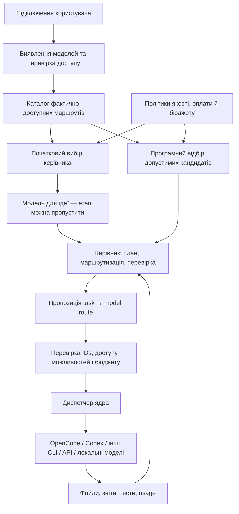

# Керівник і динамічна команда моделей

Уточнення вимог користувача від 15.11.2026. Статус: цільовий контракт наступного етапу; поточний живий Codex-запуск доводить виконання ядра, але ще не реалізує цей каталог і автоматичну маршрутизацію.

**Актуальна вимога: безкоштовні моделі та використання в межах уже наявних підписок користувача.** Оркестратор виявляє встановлені інтеграції й перевіряє доступ до акаунтів. Активна підписка може розширити каталог для всіх ролей, включно з керівником; за її відсутності залишаються підтверджені безкоштовні маршрути. Оплата за фактичні токени, платні кредити та перевищення включеного ліміту виключені. Підписка позначається окремо від безкоштовного тарифу.

## Мета продукту

Оркестратор використовує підтверджені безкоштовні моделі та моделі, включені в активні підписки користувача, через підключені облікові записи, API та CLI. Він допомагає сформувати ідею або приймає готову, будує план, сам підбирає фактичні моделі для задач, контролює результат і квоти. Керівник обирається серед найсильніших допустимих кандидатів; виконавці — за достатньою якістю для задачі та ефективністю використання безкоштовних і включених у підписку квот. Конкретні бренди не закріплені за UI, backend чи review.

OpenCode — один із конекторів. Керівник через Codex і виконавці через OpenCode можуть працювати в одному проєкті. Модель, відсутня в одному конекторі, може використовуватися через інший доступний маршрут. Наявність запису у загальному довіднику не означає доступу акаунту.

## Схема керування



Керівник пропонує рішення; програмний контролер застосовує політики й запускає виконавців. Він не може сам розширити дозволи або увімкнути оплату. Початковий вибір керівника робить контролер за політикою, підтвердженими можливостями та оцінками якості; користувач може закріпити модель. Це усуває рекурсію «модель має спочатку вибрати сама себе».

## Каталог доступу

Одиниця вибору — **ModelRoute**, а не лише назва моделі:

```text
routeId
connectionId / backend / exactProviderModelId
roles / capabilities / contextLimit
availability: discovered | ready | rate_limited | quota_exhausted | unavailable | unknown
verifiedAt / expiresAt / discoverySource
billing: free_tier | subscription_included | metered | local | unknown
entitlement: planKind? / subscriptionStatus / modelAccess / checkedAt / source
billingBoundary: included_only | may_use_paid_credits | unknown
inputPrice / cachedInputPrice / outputPrice / currency / pricingSource / pricingAt
quota: remainingKnown? / resetAt? / scope
qualityEvidence: role / score / sampleSize / provenance
```

Ту саму модель через різні облікові записи або backend потрібно зберігати окремими маршрутами: вони можуть мати різні квоти, інструменти, контекст, ціни й права. Ключі залишаються у сховищі секретів або авторизації CLI; каталог містить лише references.

Discovery адаптери отримують список із підтримуваних API/CLI підключення. Платні тестові запити заборонені. Де entitlement або залишок квоти не доступні програмно, стан залишається невідомим; успішна авторизація сама по собі не доводить доступу до кожної моделі. Невідома вартість виключає маршрут із запуску. Помилки доступу й квот оновлюють health, а не підміняються успішною відповіддю.

Система має бути розширюваною: повний каталог конкретного користувача складається з усіх підключених конекторів, а новий провайдер додається адаптером. Облікові записи, які користувач ще не підключив, не вважаються доступними автоматично.

## Виявлення підписок на комп'ютері

1. **Встановлені інтеграції.** Перевірити PATH, стандартні каталоги встановлення підтримуваних CLI, реєстрацію застосунків і налаштовані користувачем підключення. Це цільовий пошук інтеграцій; повного обходу особистих файлів, браузерних cookie чи платіжних документів не потрібно.
2. **Авторизація.** Через штатні status-команди або підтримувані API визначити спосіб входу й стан акаунту. Паролі, API-ключі та OAuth-токени не виводяться й не копіюються до каталогу. Сам executable або конфігураційний файл не доводить активної підписки.
3. **Підтвердження доступу.** Отримати підтримувані метадані тарифу, доступних моделей, включених квот і строків їх оновлення. Стан зберігається окремо: `installed`, `authenticated`, `subscriptionConfirmed`, `includedAccessConfirmed`. Якщо сервіс не відкриває ці відомості, UI показує «Підключення знайдено; тариф/доступ не підтверджено», а не вигадує підписку.
4. **Каталог моделей.** Додати лише підтверджені безкоштовні або включені у підписку маршрути. Окремий API-ключ того самого постачальника не успадковує автоматично підписку з чат-застосунку або CLI.
5. **Оновлення.** Перевіряти стан при запуску, за дією «Оновити підключення» та перед призначенням задачі. У разі завершення підписки, logout, вичерпання квоти або недоступності моделі перерахувати допустимий каталог. Недоступність сервісу не є доказом відсутності підписки: такий стан стає невідомим.

Виявлення не купує підписок, не активує додаткові кредити й не виконує модельних запитів для перевірки платних маршрутів. Призначення на керівника й виконавців використовує той самий підтверджений каталог, але різні вимоги до якості та контексту.

## Політика без додаткових списань

Для всіх ролей діє `noAdditionalCharges: true` з допустимими класами `free_tier` та `subscription_included`. Це не означає, що підписка безкоштовна: користувач уже має її, а запуск витрачає лише включений ліміт.

| Тип маршруту | Рішення |
| --- | --- |
| Підтверджений free tier | Допустимий у межах безкоштовної квоти, без автоматичного платного продовження |
| Оплата за токени або запити | Виключений, навіть якщо немає підписки |
| Використання в уже оплаченій активній підписці | Допустиме після підтвердження доступу до конкретної моделі, у межах включеної квоти |
| Платні кредити або автоматичне списання після квоти | Виключені, навіть за наявності підписки |
| Платний API з промокредитами | Не вважається підтвердженим безкоштовним тарифом |
| Невідома або застаріла вартість | Виключений до підтвердження |
| Локальні моделі | Окремий можливий режим без API-тарифу; апаратні витрати не позначаються нульовими |

Приклад цільової конфігурації: керівник через наявну підписку Codex/Claude + безкоштовні OpenCode-виконавці. Якщо підписок немає, керівник також обирається серед безкоштовних кандидатів. Якщо кандидат не справляється, допустимі інша безкоштовна модель або модель із невичерпаним включеним лімітом підписки. За відсутності кандидатів задача очікує. Автоматичні додаткові списання й поповнення балансу заборонені.

Якщо runtime може після квоти автоматично перейти на платні кредити, адаптер має забезпечити зупинку до такого переходу або підтверджений режим лише включеного використання. Власний приблизний лічильник токенів не доводить відсутності списань на стороні провайдера. Невідома межа оплати не дає права автоматично запускати маршрут.

`unknown` не означає нульову вартість. Позначка free у назві або нульова ціна вхідних токенів сама по собі недостатня: безкоштовними мають бути також вихідні токени й обов'язкові операції маршруту. Free tier може мати квоти та змінюватися; перед запуском потрібне актуальне підтвердження тарифу. Не слід вгадувати resetAt або залишок quota.

## Вибір моделі під задачу

1. Проаналізувати вимоги задачі: UI, backend, дослідження, тести, документація; складність, контекст, інструменти, вимоги до результату.
2. Програмно відфільтрувати кандидати за підтвердженим free tier або включеним доступом активної підписки, відсутністю додаткових списань, квотою, контекстом, інструментами та дозволами. Metered і невідомі за способом оплати маршрути керівнику не передаються як кандидати.
3. Передати керівнику компактну картку задачі та допустимий каталог. Він обирає `routeId`, роль, обґрунтування й резервних кандидатів. Для різних задач та етапів допустимі різні моделі; для однієї задачі — кілька виконавців або окремий рецензент.
4. Повторно перевірити пропозицію перед запуском: каталог або квота могли змінитися. Зберегти snapshot вибору й пояснення в історії.
5. Перевірити результат тестами й критеріями. За невдачі використати обмежений retry, іншого допустимого виконавця або сильнішу модель з підтвердженим free tier чи включеним доступом підписки. Кількість спроб і використання квот обмежені; ескалація з додатковою оплатою виключена.

Немає незмінного правила «Sonnet — UI, Opus — backend». Це можуть бути конкретні вибори для конкретного проєкту, якщо ці моделі доступні й є підстави для такого розподілу. Оцінки керівника слід відрізняти від виміряних evals. Автоматичний fallback після часткового запису файлів потребує перевірки workspace та результату попередньої спроби; сліпе повторне виконання не допускається.

## Економія контексту та токенів

- Керівник формує TaskBrief: мета, інструкція, потрібні файли, контракти, критерії й необхідні результати залежностей.
- Виконавець отримує контекст своєї задачі; повна історія проєкту не копіюється кожній моделі.
- Керівник отримує стислий звіт, diff, результати тестів і references на артефакти; деталі дочитує за потреби.
- Планування й контроль виконуються на контрольних точках, при зміні вимог і при збоях. Після кожного рядка коду звернення до дорогого керівника не потрібне.
- Вимірюються вхідні, cached і вихідні токени, внутрішні виклики там, де runtime їх відкриває, затримка, кількість повторів і прийнятий результат. При непрозорому CLI точність обліку явно обмежується.
- Вибір оптимізує вартість **перевіреного результату**, а не тільки кількість токенів. Дешевший виклик може програти через повтори або дефекти; економія має підтверджуватися вимірами.

## Зміни в UI

**Підключення:** знайдені CLI та акаунти, дія підключення, список доступних моделей, verified/unknown, квоти та час оновлення.

**Налаштування проєкту:** автоматичний або закріплений керівник; обов'язкова політика «Безкоштовні + наявні підписки, без додаткових списань»; дозволені провайдери, квоти та retry/escalation limits. Каталог розрізняє «Безкоштовно», «Включено у вашу підписку», «Оплата за використання» й «Не підтверджено»; два останні класи не запускаються автоматично.

**Майстер:** готова ідея пропускає концепцію; потім AI-план і реальні model routes для задач. Ручний вибір є необов'язковим override, а не обов'язковим перепризначенням усіх ролей на один Codex перед запуском.

**Виконання:** фактичні виконавці, причини вибору/заміни, роль керівника, usage, витрати або позначка невідомої вартості. Рекомендація й фактично використаний маршрут не змішуються.

## Порядок наступної реалізації

Стан реалізації станом на 15.11.2026: [каталог і політика](../MODEL-REGISTRY.md), [OpenCode та AI-керівник](../AI-DIRECTOR.md). Для Codex реалізовані discovery, точні model IDs, тариф і квоти; виклики дозволені за умов контрольованої підписки й зупиняються біля порога квоти. Для OpenCode працюють anonymous discovery, AI-призначення точних маршрутів та керовані файлові виконавці з нульовими тарифами. UI застосовує серверний proposal; виконання використовує окремі worktree, обмежених субагентів та SSE. [Поточна реалізація](../ISOLATED-EXECUTION.md). Решта етапів нижче залишається цільовою архітектурою.

1. Єдиний ModelRoute Registry, discovery/health і provenance для підключених runtime; спочатку поточний Codex та OpenCode, далі інші адаптери.
2. Відбір без додаткових списань: тести включення підтвердженої активної підписки й free tier; виключення metered, прострочених підписок, платних кредитів, unknown, платного fallback та вичерпаних квот.
3. Заміна статичних профілів у плануванні й ручних Codex bindings на AI-призначення точних route IDs, перевірені сервером.
4. TaskBrief/Context Builder, bounded retries та ескалація з журналом причин і usage.
5. Паралельні виконавці в окремих worktree, інтеграція й оцінка вартості прийнятого результату.

## Перевірені джерела щодо OpenCode

- [Моделі](https://opencode.ai/docs/models/): доступність залежить від проєкту та підключення; вибір конкретного model ID; free-моделі та їх відображення.
- [Провайдери](https://opencode.ai/docs/providers/): підключення акаунтів, включене у підписку використання та локальні runtime.
- [CLI](https://opencode.ai/docs/cli/): `opencode run` і окремий або спільний сервер.

Стан на 15.11.2026: OpenCode V2 встановлений локально у приватній папці проєкту; живий anonymous-каталог повернув 12 моделей із нульовими тарифами. Claude Code й Ollama не знайдені у перевірених місцях. Наявність підписок в інших середовищах не вгадується; поточний список free-моделей перевіряється перед викликами.

Codex metadata API надає тип тарифу через `account/read`, список моделей через `model/list` і квоти через `account/rateLimits/read`. Дані конкретного акаунта залишаються локальними. Межа лише включеного використання залишається непідтвердженою, тому нові запити блокуються політикою. `login status` сам по собі такого підтвердження не дає. [Автентифікація Codex](https://learn.chatgpt.com/docs/auth), [включене використання та кредити](https://learn.chatgpt.com/docs/pricing).


Актуальні умови використання Codex за підпискою: [контроль квоти та білінгу](../CODEX-SUBSCRIPTION.md).
