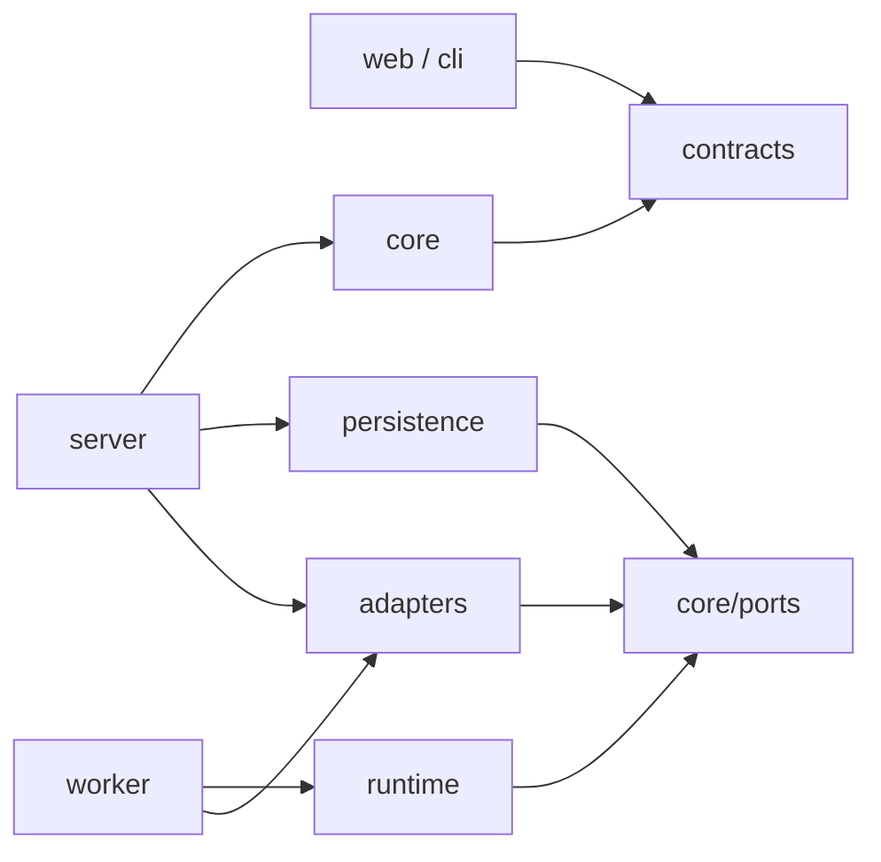

# Структура репозиторію

Статус: цільова структура; каталоги нижче ще не створюються автоматично. [Навігація](README.md).

## 1. Дерево

```text
orcestrator/
├─ apps/
│  ├─ server/                   # HTTP, SSE, внутрішній worker API, composition root
│  │  └─ src/{routes,auth,bootstrap}/
│  ├─ worker/                   # Отримання jobs, heartbeat, runtime, shutdown
│  │  └─ src/{runner,supervisor,bootstrap}/
│  ├─ web/                      # Локальна панель користувача
│  │  └─ src/{app,features,components}/
│  └─ cli/                      # Клієнт того самого API, локальний launcher
│     └─ src/commands/
├─ packages/
│  ├─ contracts/                # Версійовані DTO, schemas, events, worker protocol
│  │  └─ src/{api,events,worker,validation}/
│  ├─ core/                     # Домен та прикладні сценарії
│  │  └─ src/
│  │     ├─ domain/             # Сутності, переходи станів, чисті правила
│  │     ├─ projects/           # Створення, ревізії, архівування
│  │     ├─ agents/             # Профілі, каталог, routing
│  │     ├─ planning/           # План, версії та зміни графа
│  │     ├─ orchestration/      # Run/Task lifecycle, стратегії команд
│  │     ├─ scheduling/         # Пріоритети, ready queue, leases
│  │     ├─ policy/             # Права, approvals, бюджетні дозволи
│  │     ├─ context/            # ContextBuilder та пам'ять
│  │     ├─ usage/              # Резервування, usage ledger, оцінки
│  │     └─ ports/              # Store, Runtime, Queue, Secrets, Clock, Artifacts
│  ├─ runtime/                  # Виконання, незалежне від HTTP сервера
│  │  └─ src/{agent-loop,sessions,tools,processes,workspace}/
│  ├─ adapters/                 # Інтеграції зовнішніх контрактів
│  │  └─ src/
│  │     ├─ models/             # API провайдерів; окремий каталог на протокол
│  │     ├─ agents/             # CLI Codex, Claude, generic CLI
│  │     ├─ tools/              # Контрольовані filesystem/shell/MCP
│  │     └─ secrets/            # Environment, OS vault
│  ├─ persistence/              # SQLite, міграції, транзакції, jobs, outbox
│  │  ├─ migrations/
│  │  └─ src/{repositories,transactions,artifacts}/
│  └─ testing/                  # Fake runtime, clock, fixtures; тільки dev
├─ tests/
│  ├─ integration/              # БД + диспетчер + worker
│  ├─ contracts/                # Той самий набір для кожного адаптера
│  ├─ recovery/                 # Падіння між критичними кроками
│  └─ e2e/                      # UI → API → fake/real opt-in runtime
├─ examples/                    # Приклади проєктів без секретів
├─ scripts/                     # Dev, packaging, migration tools
├─ docs/
│  ├─ architecture/             # Ці документи
│  ├─ adr/                      # Окремі рішення після початку реалізації
│  └─ api/                      # Згенерована OpenAPI/worker reference
├─ package.json                 # npm workspaces та команди
└─ package-lock.json            # Фіксація залежностей реалізації
```

Доменні модулі всередині `core` розділяються за відповідальністю. Виносити кожен у пакет слід лише коли з'явиться окремий споживач або цикл релізів. Спільний UI-пакет не потрібен до появи другого інтерфейсу.

## 2. Напрям залежностей



- `core/domain` не імпортує HTTP-фреймворк, SQLite, Node child_process, SDK моделей чи React.
- `core/ports` задає інтерфейси. Реальні adapters підставляють `apps/*/bootstrap`.
- `contracts` містить DTO та schemas, не класи БД або secrets. Runtime-валідація потрібна на кожній зовнішній межі.
- `web` та `cli` не читають БД, файлову систему worker чи стан процесів напряму.
- `worker` не імпортує реалізацію SQLite і не редагує Run напряму; використовує внутрішній протокол.
- Adapter не викликає інший adapter в обхід прикладного сценарію. Наприклад, model adapter повертає tool request, а runtime передає його контрольованому ToolExecutor.
- Правила імпортів перевіряє dependency check у CI. Циклічні залежності між пакетами заборонені.

## 3. Основні порти

Це контракти поведінки, не готові TypeScript declarations.

| Порт | Основні операції | Умови |
| --- | --- | --- |
| ProjectRepository | getRevision, saveRevision | Optimistic concurrency; immutable version |
| UnitOfWork | transaction | Стан + event + outbox + ресурсний резерв атомарні |
| JobQueue | claim, renew, finish, recover | Lease token; повторні повідомлення допустимі |
| AgentRuntime | probe, start, events, cancel, inspect | Підтримка resume/steer оголошується capabilities |
| ModelClient | capabilities, generate | Повертає normalized content, usage і raw reference |
| ToolExecutor | describe, invoke, inspect | Policy decision + invocation key перед побічним ефектом |
| WorkspaceManager | allocate, snapshot, diff, integrate, release | Лише керовані roots; base commit і lease |
| ArtifactStore | stage, commit, read, retire | Content hash; зв'язок із producer та retention |
| SecretStore | resolve(reference, scope) | Значення не потрапляє у DTO чи події |
| EventLog | append, readAfter | Стабільний курсор, версія payload, deduplication |
| Clock | now, delay | Тестовані lease expiry, deadline, backoff |

Операції `cancel` та `inspect` повертають підтверджений стан і рівень гарантії, а не просто `void`. Команда зупинки й підтвердження зупинки — різні події.

## 4. Конфігурація та локальні дані

Розділяємо versioned project config і machine config. У project config: цілі, профілі/версії, план, policies та references. У machine config: адреси сервера, шляхи executable, resource pools, secret mappings, робочі roots. Абсолютний локальний шлях не є переносимою ідентичністю проєкту.

```text
<data-root>/
├─ db/orcestrator.sqlite
├─ artifacts/<content-hash>/
├─ workspaces/<run-id>/<workspace-id>/
├─ logs/                       # Ротація і редагування секретів
├─ cache/                      # Відтворювані тимчасові дані
└─ backups/                    # Узгоджені backups БД + manifest артефактів
```

Ці каталоги не входять у Git. База та артефакти мають різні retention policies. Видалення проєкту спочатку архівує його; фізичний cleanup можливий після завершення jobs, перевірки references та терміну зберігання.

## 5. Перенесення поточного прототипу

| Поточний файл | Цільове місце | Що змінюється |
| --- | --- | --- |
| `src/domain.js` | `core/domain`, `contracts/validation`, `core/agents` | Сутності відділяються від DTO та алгоритму routing |
| `src/engine.js` | `core/orchestration`, `scheduling`, `policy`, `usage` | Стани, черга, команди й ресурси стають окремими компонентами |
| `src/providers.js` | `adapters/models`, `adapters/agents`, `runtime/processes` | Розділення API-клієнта, циклу агента й керування процесом |
| `src/store.js` | `persistence` | Транзакції, міграції, events/outbox, jobs замість загального JSON |
| `src/server.js` | `apps/server` | Версійовані маршрути, schemas, auth, worker protocol, SSE |
| `src/cli.js` | `apps/cli`, `apps/worker` | CLI стає клієнтом, а не другим незалежним власником сховища |
| `test/*` | Unit, contract та integration suites | Зберігаємо поведінкові сценарії; доповнюємо recovery та policy |

Перенесення виконується вертикальними сценаріями: спочатку створення проєкту і одна задача, потім паралельність і команди, далі делегування та Git. Порожні пакети і заглушки під усі майбутні функції наперед не створюються.
