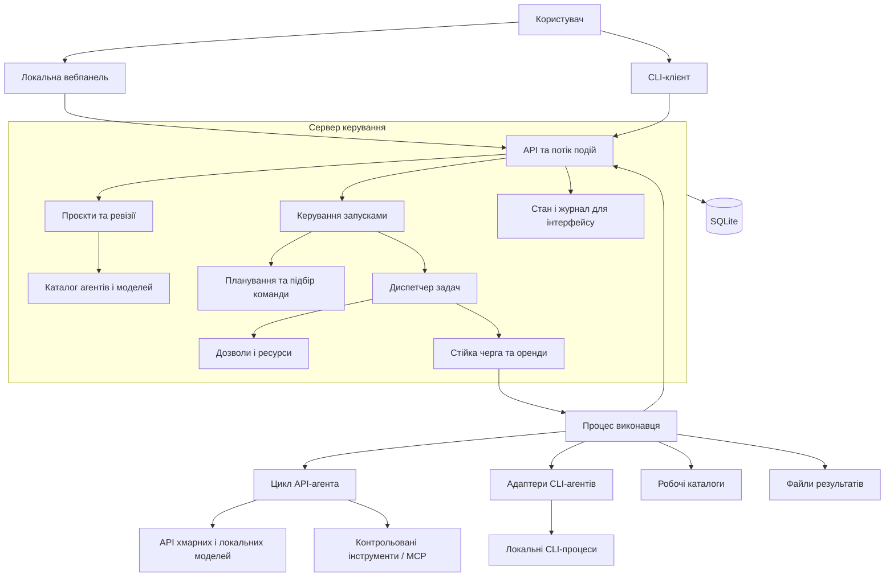

# Архітектура системи

Статус: цільовий дизайн, не опис уже реалізованої системи. [Навігація](README.md).

## 1. Межі системи

Процес керування володіє станом. Worker отримує завдання через автентифікований внутрішній API та передає події, heartbeat і результат. Прямого запису worker у доменні таблиці немає. Для локального режиму обидва процеси запускає один launcher.

## 2. Модулі та відповідальність

| Модуль | Володіє | Не повинен робити |
| --- | --- | --- |
| Projects | Цілі, джерела, обмеження, ревізії, критерії приймання | Запускати процеси |
| Registry | Провайдери, моделі, профілі агентів, capabilities, доступність | Призначати роботу без політики запуску |
| Planning | Пропозиція графа задач і команд, версії плану | Самостійно змінювати активний граф або права |
| Routing | Відбір кандидатів, оцінки, пояснення, fallback-кандидати | Видавати здогад про якість за виміряний факт |
| Orchestration | Стани Run/Task, стратегії команд, делегування, перевірка результатів | Викликати SDK провайдера напряму |
| Scheduling | Готовність задач, пріоритети, ліміти, оренди, справедливість між проєктами | Приймати змістові рішення за модель |
| Policy | Права, погодження, бюджетні дозволи, заборони | Передавати агенту можливість розширити свої права |
| Context | Збір вхідних матеріалів, походження, дозволи, ліміти контексту | Безконтрольно передавати весь проєкт усім агентам |
| Runtime | API-цикл агента, CLI-сесії, streaming, завершення процесів | Вважати exit code доказом правильності результату |
| Tools | Виклики інструментів, MCP-адаптери, результати, журнал побічних ефектів | Обходити policy або мати власне незалежне призначення задач |
| Workspaces | Робочі каталоги, оренди, зміни, інтеграція | Зливати неперевірені зміни в основну гілку |
| Artifacts | Вихідні файли, content hash, звіти тестів, diff | Зберігати великі файли всередині запису Run |
| Usage | Usage, оцінки та підтверджені витрати, резерви, тарифи | Позначати невідому вартість нулем |
| Events | Послідовність подій, аудит, доставка до клієнта | Бути єдиним джерелом поточного стану без транзакційних таблиць |

Модулі логічні. Не кожен модуль потребує окремого npm-пакета; структура пакетів описана в [STRUCTURE.md](STRUCTURE.md).

## 3. Модель, агент, сесія і виклик

- **ProviderConnection**: налаштоване підключення до сервісу або локального endpoint, secret reference, стан здоров'я.
- **ModelDescriptor**: конкретна модель, modalities, розмір контексту, tool calling, structured output, ціни та час останньої перевірки цих відомостей.
- **AgentProfileVersion**: роль, інструкції, навички, execution backend, допустимі моделі, інструменти, правила делегування, тип пам'яті.
- **AgentSession**: робочий контекст агента в конкретному запуску, журнал повідомлень, backend session handle та права. За замовчуванням не розділяється між незалежними задачами.
- **Invocation**: один запущений виклик runtime у межах спроби задачі. API-цикл може породити кілька модельних запитів; CLI-виклик може містити непрозорий внутрішній цикл.
- **ModelRequest / ToolCall**: найменші видимі одиниці використання моделі та інструментів. Облік точності видимості — обов'язковий.

Наприклад, «Backend Developer» — профіль, а обрана модель і backend — його конфігурація. Той самий профіль може мати API- та CLI-варіанти з різними можливостями, але ці варіанти не вважаються автоматично взаємозамінними.

## 4. API-моделі та CLI-агенти

Є два execution backend:

1. `managed-api`: оркестратор керує історією, зверненнями до моделі, викликами інструментів, лімітами кроків і делегуванням. Текстова генерація — найпростіший режим цього backend.
2. `external-agent`: зовнішній CLI вже керує своїм циклом. Адаптер нормалізує його доступні події, сесії, usage, файлові зміни й керування життєвим циклом.

Capabilities описуються окремими ознаками: `streaming`, `structuredOutput`, `toolCalls`, `resumeSession`, `steering`, `nativeSubagents`, `usageReporting`, `hardCostLimit`, `processTreeControl`, `sandboxKind`, `artifactExport`. Для кожної — `supported | unsupported | unknown` і дані перевірки версії backend.

Якщо CLI має власних субагентів, інтерфейс позначає їх як **backend-managed**. Оркестратор не обіцяє окремо призначати, зупиняти чи рахувати їхні витрати без підтримки адаптера. Керовані оркестратором субагенти мають власні задачі, сесії та оренди.

API сумісність не гарантує підтримки всіх можливостей. Адаптер окремо перевіряє формат usage, інструменти, structured output та ліміти. Версії CLI і capabilities фіксуються в запуску; зміна CLI не повинна непомітно змінювати незавершену спробу.

## 5. Підбір команди

Підбір відбувається під час створення/редагування проєкту як рекомендація та повторно перед фактичним запуском як перевірка доступності.

**Крок 1 — обов'язкові умови.** Потрібні інструменти, формат результату, контекст, дозволений провайдер, data residency, можливість роботи з репозиторієм, доступність облікових даних, сумісність ОС, бюджетна політика. Недопустимі кандидати відкидаються, незалежно від оцінки навичок.

**Крок 2 — оцінка кандидатів.** Збіг навичок, результати eval на подібних задачах, оцінена вартість, latency, надійність, поточне навантаження. Ваги задає routing policy: якість / швидкість / економія / збалансований режим. Відсутні вимірювання позначаються як невідомі; confidence зберігається окремо від score.

**Крок 3 — склад команди.** Підбираємо рольові слоти: виконавець, рецензент, арбітр, інтегратор. Перевіряємо сукупний бюджет і вимоги незалежності рецензента. Для порівняння відповідей можна вимагати різні моделі/провайдери. Усі явні ручні призначення проходять ті самі обов'язкові умови.

**Крок 4 — фіксація рішення.** Зберігаємо кандидатів, причини відмови, версію policy, оцінки, профіль/модель/backend, fallback-порядок та хто змінив рекомендацію. UI показує пояснення «обрано через…» і причину блокування.

Перемикання на fallback створює новий Invocation або TaskAttempt, а не підмінює вже виконаний виклик. Перенесення сесії між провайдерами потребує нормалізованого контексту; native session ID іншого backend не використовується.

## 6. Контекст і пам'ять

Шари контексту: правила системи → профіль агента → ревізія проєкту → задача → прийняті результати залежностей → дозволені матеріали. Джерела містять URI, hash/версію, час отримання та рівень довіри. Інструкції із зовнішніх документів не стають системною політикою.

Пам'ять поділяється на сесійну, прийняті знання проєкту та особисті налаштування користувача. Агент може запропонувати запис у пам'ять; прийняття й provenance зберігаються окремо. Неперевірена відповідь іншого агента не позначається підтвердженим фактом.

Перед кожним викликом ContextBuilder застосовує права і token budget. Скорочення має залишати посилання на повні артефакти та позначати відкинуті матеріали. Для CLI, де внутрішній контекст невидимий, вказується `visibility=partial`.

## 7. Дані, процеси та технології

Пропонований стек: TypeScript, Node.js runtime, React для локальної панелі, HTTP JSON API + SSE для подій. Це вибір проєктування; конкретні версії та бібліотеки фіксуються окремим lockfile під час реалізації. HTTP-фреймворк, ORM і бібліотека графів не повинні проникати в домен.

SQLite — початкове транзакційне сховище на одному комп'ютері. Обираємо короткі транзакції, WAL, керовані міграції, індекси та backup. WAL допускає одночасних читачів із writer, але одночасний writer один; база WAL не призначена для мережевої файлової системи. Це обмежує локальний deployment, а не кількість зовнішніх модельних запитів. [SQLite WAL](https://www.sqlite.org/wal.html).

Стан і durable jobs зберігаються в БД; великий вивід і файли — в artifact store. Redis і окремий брокер не потрібні в першій реалізації. Перехід до PostgreSQL потрібен для кількох хостів і вищого навантаження запису; його транзакційні властивості перевіряються окремо, а не приховуються за «універсальним SQL».

## 8. Робочі каталоги та права

Для незалежних редакторів — окремі Git worktree від зафіксованого base commit; для некодових задач — окремі каталоги артефактів. Залежна задача отримує точний інтегрований snapshot результатів своїх залежностей. Інтегратор працює в окремій гілці й повторює перевірки після злиття.

Git worktree має окремі робочі файли, проте використовує спільні дані репозиторію. Він забезпечує організацію паралельних змін; ізоляцію ОС слід забезпечувати окремо. [Git worktree](https://git-scm.com/docs/git-worktree).

Усі права задаються структуровано: файлові корені, дозволені дії інструментів, мережеві напрями, доступ до secrets, делегування. Worker видає лише потрібні credentials і мінімальне середовище. Для Windows процесний адаптер має окрему реалізацію запуску й завершення дерева; підтримка wrapper-файлів перевіряється явно. Node документує особливості `.cmd`/`.bat` та запуску дочірніх процесів на Windows. [Node child process](https://nodejs.org/api/child_process.html).

Секрети зберігаються через SecretStore; у БД та подіях — лише references. Локальний початковий адаптер може читати environment, наступний — системне сховище. Worktree, CI-артефакти, логи і кеші не отримують секрети автоматично.

## 9. Основні архітектурні рішення

| Рішення | Причина | Наслідок / умова перегляду |
| --- | --- | --- |
| Модульний моноліт + worker | Простий локальний запуск, окремий життєвий цикл CLI | Перенесення worker на інший хост через той самий протокол |
| Структурований контролер + AI-планувальник | Перевірені переходи станів і пояснювані пропозиції | Модель не є джерелом дозволу чи власником черги |
| Ревізії + snapshots | Відтворюваність конфігурації | Точна відповідь моделі не гарантується навіть з однаковими входами |
| Два execution backend | API і CLI мають різну керованість | UI відображає відсутні можливості, не імітує їх |
| Транзакційний стан + журнал + outbox | Узгодженість результату й подій | Повне event sourcing не вводиться на старті |
| SQLite на одному хості | Локальна інсталяція без окремого DB-сервера | PostgreSQL — явний режим масштабування |
| Окремі робочі каталоги | Паралельні зміни та конкретний diff | Потрібна окрема інтеграційна перевірка |
